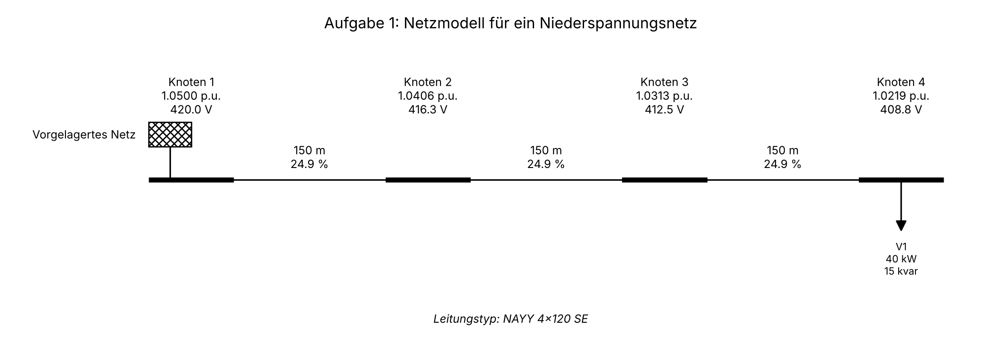
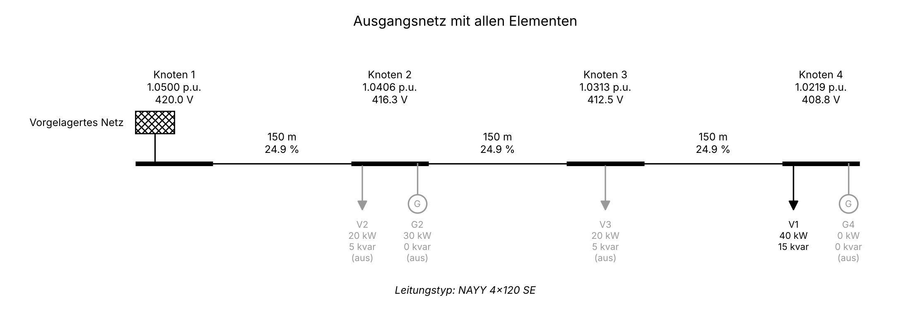
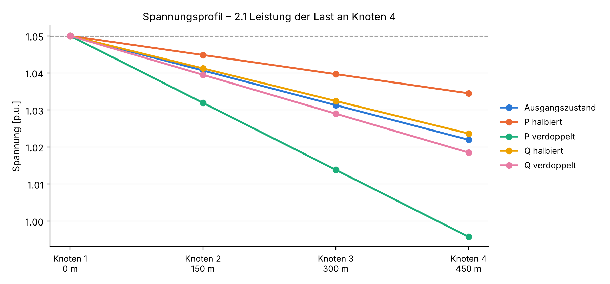
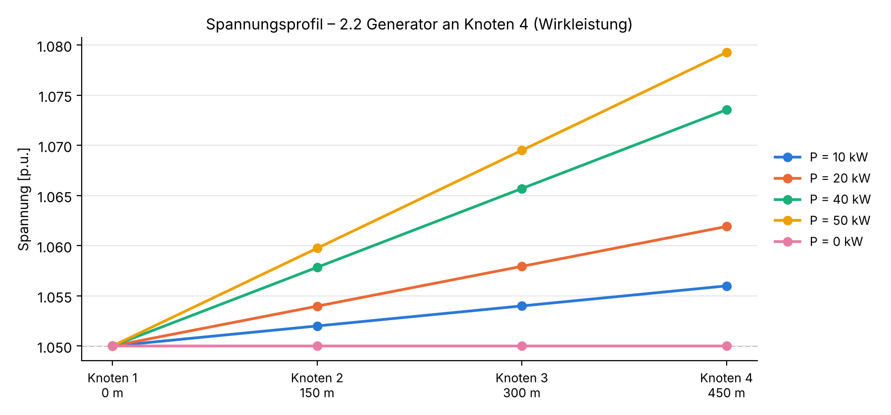
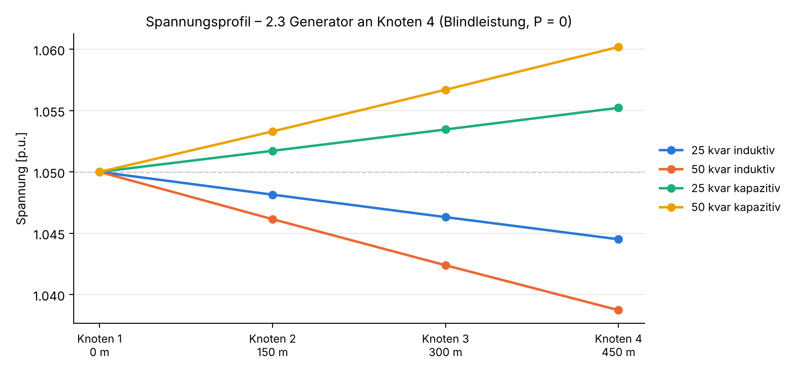
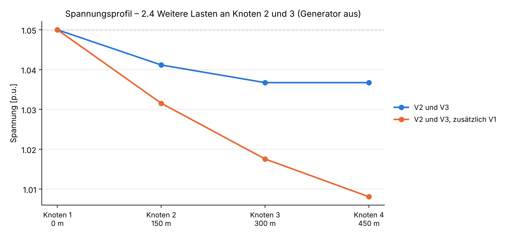
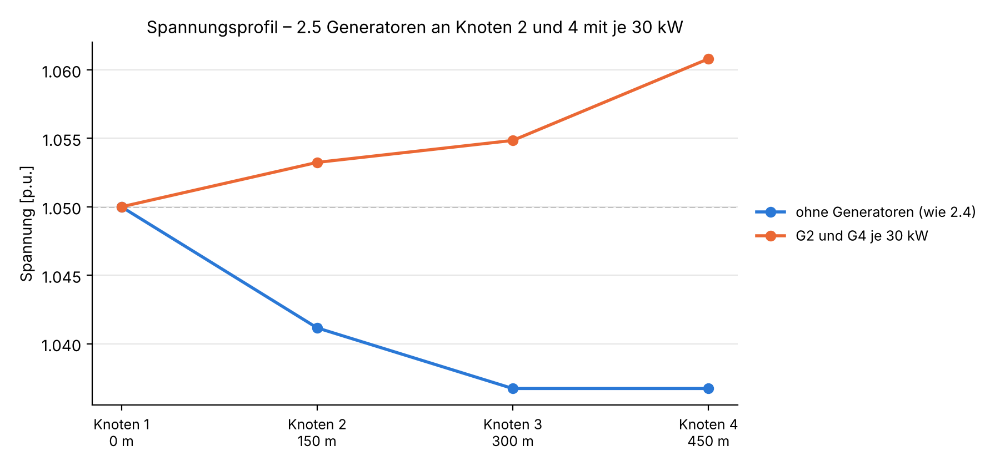
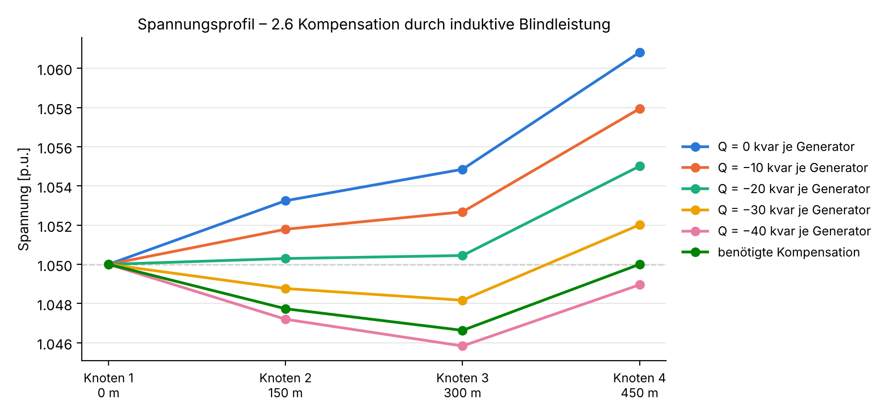

# Labor EAN-V4: Einführung in die Netzberechnung

Labor Elektrische Anlagen und Netze 1, WS 2026/27

| | |
| :--- | :--- |
| Name | Julian Fehre |
| Datum | 18.11.2026 |
| Code | [github.com/CodeJF06/Pandapower_ElAuN_HSFL](https://github.com/CodeJF06/Pandapower_ElAuN_HSFL/tree/main/EAN-V4) |

Alle Ergebnisse wurden mit pandapower berechnet und von den Python-Skripten
automatisch erzeugt:

| Datei | Inhalt |
| :--- | :--- |
| `EAN-V4/aufgabe1_grundgeruest.py` | Netzmodell Aufgabe 1, einfache Fassung |
| `EAN-V4/aufgabe1.py` | Aufgabe 1: Netzdaten, Aufruf von `netzberechnung.py` |
| `EAN-V4/aufgabe2_grundgeruest.py` | Teilaufgaben 2.1–2.6, einfache Fassung |
| `EAN-V4/aufgabe2.py` | Aufgabe 2: Netzdaten, Varianten und Beobachtungen |
| `EAN-V4/abgabe.py` | rechnet beide Aufgaben und erzeugt diese Datei |
| `EAN-V4/ergebnisse/` | Ergebnisse je Aufgabe und alle Bilder |
| `netzberechnung.py` | gemeinsamer Code: Lastfluss, Tabellen, Netzplan, Spannungsprofile |

## Inhalt

- [Aufgabe 1: Netzmodell für ein Niederspannungsnetz](#aufgabe-1-netzmodell-für-ein-niederspannungsnetz)
- [Aufgabe 2: Erweiterung des Netzmodells](#aufgabe-2-erweiterung-des-netzmodells)

---

## Aufgabe 1: Netzmodell für ein Niederspannungsnetz

### Einlinienersatzschaltbild

### Leitungstypen

| Leitungstyp | R' [Ω/km] | X' [Ω/km] | X/R | I_max [A] |
| :--- | ---: | ---: | ---: | ---: |
| NAYY 4x120 SE | 0.225 | 0.080 | 0.356 | 242 |

### Lasten und Generatoren (eingestellt)

| Element | Art | Knoten | in Betrieb | P [kW] | Q [kvar] |
| :--- | :--- | :--- | :--- | ---: | ---: |
| V1 | Last | Knoten 4 | ja | 40.00 | 15.00 |

### Knotenspannungen

| Knoten | U [p.u.] | U [V] | Winkel [°] |
| :--- | ---: | ---: | ---: |
| Knoten 1 | 1.0500 | 420.0 | 0.000 |
| Knoten 2 | 1.0406 | 416.3 | 0.009 |
| Knoten 3 | 1.0313 | 412.5 | 0.017 |
| Knoten 4 | 1.0219 | 408.8 | 0.026 |

### Leitungen

| von | nach | Länge [m] | I [A] | Auslastung [%] | P_Verlust [kW] | Q_Verlust [kvar] |
| :--- | :--- | ---: | ---: | ---: | ---: | ---: |
| Knoten 1 | Knoten 2 | 150 | 60.3 | 24.9 | 0.369 | 0.129 |
| Knoten 2 | Knoten 3 | 150 | 60.3 | 24.9 | 0.369 | 0.129 |
| Knoten 3 | Knoten 4 | 150 | 60.3 | 24.9 | 0.369 | 0.129 |

### Externes Netz

Positive Werte: Bezug aus dem vorgelagerten Netz, negative: Rückspeisung.

| Externes Netz | Knoten | U_soll [p.u.] | P [kW] | Q [kvar] |
| :--- | :--- | ---: | ---: | ---: |
| Vorgelagertes Netz | Knoten 1 | 1.05 | 41.11 | 15.39 |

---

## Aufgabe 2: Erweiterung des Netzmodells

### Netzmodell

Alle in Aufgabe 2 verwendeten Elemente; ausgeschaltete sind grau dargestellt. Spannungen und Auslastungen gelten für den Ausgangszustand.

#### Leitungstypen

| Leitungstyp | R' [Ω/km] | X' [Ω/km] | X/R | I_max [A] |
| :--- | ---: | ---: | ---: | ---: |
| NAYY 4x120 SE | 0.225 | 0.080 | 0.356 | 242 |

#### Elemente im Ausgangszustand

| Element | Art | Knoten | in Betrieb | P [kW] | Q [kvar] |
| :--- | :--- | :--- | :--- | ---: | ---: |
| V1 | Last | Knoten 4 | ja | 40.00 | 15.00 |
| V2 | Last | Knoten 2 | nein | 20.00 | 5.00 |
| V3 | Last | Knoten 3 | nein | 20.00 | 5.00 |
| G4 | Generator | Knoten 4 | nein | 0.00 | 0.00 |
| G2 | Generator | Knoten 2 | nein | 30.00 | 0.00 |

#### Vorzeichen

- Lasten: P, Q > 0 = Bezug (Q > 0 induktiv).
- Generatoren: P > 0 = Einspeisung; Q < 0 = Aufnahme von Blindleistung (induktiv), Q > 0 = Abgabe (kapazitiv).
- Externes Netz: P, Q > 0 = Bezug aus dem vorgelagerten Netz, < 0 = Rückspeisung.

### 2.1 Leistung der Last an Knoten 4

| Variante | Einstellung | U Knoten 1 [p.u.] | U Knoten 2 [p.u.] | U Knoten 3 [p.u.] | U Knoten 4 [p.u.] | P ext. Netz [kW] | Q ext. Netz [kvar] | max. Auslastung [%] |
| :--- | :--- | ---: | ---: | ---: | ---: | ---: | ---: | ---: |
| Ausgangszustand | – | 1.0500 | 1.0406 | 1.0313 | 1.0219 | 41.11 | 15.39 | 24.9 |
| P halbiert | V1: P = 20 kW | 1.0500 | 1.0448 | 1.0397 | 1.0345 | 20.37 | 15.12 | 14.4 |
| P verdoppelt | V1: P = 80 kW | 1.0500 | 1.0319 | 1.0138 | 0.9957 | 84.23 | 16.50 | 48.8 |
| Q halbiert | V1: Q = 7.5 kvar | 1.0500 | 1.0412 | 1.0324 | 1.0236 | 41.00 | 7.85 | 23.7 |
| Q verdoppelt | V1: Q = 30 kvar | 1.0500 | 1.0395 | 1.0290 | 1.0185 | 41.53 | 30.54 | 29.3 |

**Erwartung:** Mehr Leistung bedeutet mehr Strom und damit einen größeren Spannungsfall (ΔU ≈ (R·P + X·Q) / U).

**Beobachtung:** Der Spannungsfall bis Knoten 4 liegt im Ausgangszustand bei 0,028 p.u. Halbe Wirkleistung verringert ihn auf 0,016 p.u., doppelte vergrößert ihn auf 0,054 p.u. (Knoten 4 sinkt auf 0,996 p.u.). Halbe bzw. doppelte Blindleistung ändert ihn nur auf 0,026 bzw. 0,032 p.u. Die Wirkleistung wirkt also deutlich stärker, weil beim Kabel R' größer ist als X' (X/R = 0,36). Die Auslastung steigt mit der Scheinleistung (P doppelt: 48,8 %, Q doppelt: 29,3 %). Das externe Netz liefert die Last plus die Leitungsverluste (Ausgangszustand 41,11 kW, d. h. 1,11 kW Verluste).

### 2.2 Generator an Knoten 4 (Wirkleistung)

Gemeinsame Einstellung: V1: aus; G4: an

| Variante | Einstellung | U Knoten 1 [p.u.] | U Knoten 2 [p.u.] | U Knoten 3 [p.u.] | U Knoten 4 [p.u.] | P ext. Netz [kW] | Q ext. Netz [kvar] | max. Auslastung [%] |
| :--- | :--- | ---: | ---: | ---: | ---: | ---: | ---: | ---: |
| P = 10 kW | G4: P = 10 kW | 1.0500 | 1.0520 | 1.0540 | 1.0560 | −9.94 | 0.01 | 5.6 |
| P = 20 kW | G4: P = 20 kW | 1.0500 | 1.0540 | 1.0579 | 1.0619 | −19.78 | 0.07 | 11.2 |
| P = 40 kW | G4: P = 40 kW | 1.0500 | 1.0578 | 1.0657 | 1.0735 | −39.12 | 0.31 | 22.2 |
| P = 50 kW | G4: P = 50 kW | 1.0500 | 1.0597 | 1.0695 | 1.0793 | −48.64 | 0.48 | 27.6 |
| P = 0 kW | G4: P = 0 kW | 1.0500 | 1.0500 | 1.0500 | 1.0500 | 0.00 | −0.01 | 0.0 |

**Beobachtung:** Mit Einspeisung kehrt sich der Leistungsfluss um: Die Spannung steigt vom Speiseknoten zum Generator hin an, etwa proportional zur Wirkleistung (50 kW: Knoten 4 bei 1,079 p.u., +0,029 p.u.). Der Speiseknoten bleibt als Slack fest bei 1,05 p.u. Das externe Netz nimmt die eingespeiste Leistung abzüglich der Leitungsverluste auf (negatives P; 50 kW → 48,64 kW, also 1,36 kW Verluste) und liefert die geringe Blindleistung der Leitungen. Bei P = 0 kW ist das Netz unbelastet, alle Knoten liegen bei 1,05 p.u.

### 2.3 Generator an Knoten 4 (Blindleistung, P = 0)

Gemeinsame Einstellung: V1: aus; G4: an

| Variante | Einstellung | U Knoten 1 [p.u.] | U Knoten 2 [p.u.] | U Knoten 3 [p.u.] | U Knoten 4 [p.u.] | P ext. Netz [kW] | Q ext. Netz [kvar] | max. Auslastung [%] |
| :--- | :--- | ---: | ---: | ---: | ---: | ---: | ---: | ---: |
| 25 kvar induktiv | G4: Q = −25 kvar (induktiv) | 1.0500 | 1.0481 | 1.0463 | 1.0445 | 0.36 | 25.12 | 14.3 |
| 50 kvar induktiv | G4: Q = −50 kvar (induktiv) | 1.0500 | 1.0461 | 1.0424 | 1.0387 | 1.47 | 50.51 | 28.7 |
| 25 kvar kapazitiv | G4: Q = 25 kvar (kapazitiv) | 1.0500 | 1.0517 | 1.0535 | 1.0552 | 0.36 | −24.88 | 14.1 |
| 50 kvar kapazitiv | G4: Q = 50 kvar (kapazitiv) | 1.0500 | 1.0533 | 1.0567 | 1.0602 | 1.41 | −49.51 | 28.1 |

**Beobachtung:** Induktive Blindleistung (Aufnahme) senkt die Spannung am Generator, kapazitive (Abgabe) hebt sie an: 50 kvar induktiv −0,011 p.u., 50 kvar kapazitiv +0,010 p.u. Im Vergleich zu 50 kW Wirkleistung (+0,029 p.u.) wirkt Blindleistung nur etwa ein Drittel so stark (X/R = 0,36). Die Blindleistung wird vollständig vom externen Netz geliefert bzw. aufgenommen, die Wirkleistung am Speiseknoten entspricht nur den Verlusten (ca. 1,4 kW). Obwohl keine Wirkleistung übertragen wird, sind die Leitungen zu etwa 28 % ausgelastet, weil der Blindstrom sie ebenfalls belastet.

### 2.4 Weitere Lasten an Knoten 2 und 3 (Generator aus)

Gemeinsame Einstellung: V1: aus; V2: an; V3: an

| Variante | Einstellung | U Knoten 1 [p.u.] | U Knoten 2 [p.u.] | U Knoten 3 [p.u.] | U Knoten 4 [p.u.] | P ext. Netz [kW] | Q ext. Netz [kvar] | max. Auslastung [%] |
| :--- | :--- | ---: | ---: | ---: | ---: | ---: | ---: | ---: |
| V2 und V3 | – | 1.0500 | 1.0412 | 1.0367 | 1.0367 | 40.42 | 10.14 | 23.7 |
| V2 und V3, zusätzlich V1 | V1: an | 1.0500 | 1.0315 | 1.0175 | 1.0081 | 82.64 | 25.93 | 49.2 |

**Beobachtung:** Die Spannung fällt vom Speiseknoten zum Strangende monoton ab. Der Spannungsfall je Abschnitt wird nach hinten kleiner, weil hinter jeder Last weniger Strom fließt: Mit V2 und V3 0,0088 / 0,0045 / 0 p.u. (hinter Knoten 3 fließt kein Strom mehr, Knoten 3 und 4 haben dieselbe Spannung). Mit zusätzlich V1 0,0185 / 0,0140 / 0,0094 p.u., insgesamt 0,042 p.u. (ca. 4 %).

### 2.5 Generatoren an Knoten 2 und 4 mit je 30 kW

Gemeinsame Einstellung: V1: aus; V2: an; V3: an; G4: an, P = 30 kW; G2: an

| Variante | Einstellung | U Knoten 1 [p.u.] | U Knoten 2 [p.u.] | U Knoten 3 [p.u.] | U Knoten 4 [p.u.] | P ext. Netz [kW] | Q ext. Netz [kvar] | max. Auslastung [%] |
| :--- | :--- | ---: | ---: | ---: | ---: | ---: | ---: | ---: |
| ohne Generatoren (wie 2.4) | G2: aus; G4: aus | 1.0500 | 1.0412 | 1.0367 | 1.0367 | 40.42 | 10.14 | 23.7 |
| G2 und G4 je 30 kW | – | 1.0500 | 1.0532 | 1.0548 | 1.0608 | −19.71 | 10.09 | 16.9 |

**Beobachtung:** Mit 60 kW Erzeugung bei 40 kW Last wird ins vorgelagerte Netz zurückgespeist (19,71 kW). Alle Knoten hinter dem Speiseknoten liegen jetzt über 1,05 p.u., die Spannung steigt zum Strangende hin an (Knoten 4: 1,061 p.u., gegenüber 2.4 um 0,024 p.u. höher). Die Auslastung sinkt von 23,7 % auf 16,9 %, weil ein Großteil der Last lokal gedeckt wird.

### 2.6 Kompensation durch induktive Blindleistung

Gemeinsame Einstellung: V1: aus; V2: an; V3: an; G4: an, P = 30 kW; G2: an

| Variante | Einstellung | U Knoten 1 [p.u.] | U Knoten 2 [p.u.] | U Knoten 3 [p.u.] | U Knoten 4 [p.u.] | P ext. Netz [kW] | Q ext. Netz [kvar] | max. Auslastung [%] |
| :--- | :--- | ---: | ---: | ---: | ---: | ---: | ---: | ---: |
| Q = 0 kvar je Generator | G2: Q = 0 kvar; G4: Q = 0 kvar | 1.0500 | 1.0532 | 1.0548 | 1.0608 | −19.71 | 10.09 | 16.9 |
| Q = −10 kvar je Generator | G2: Q = −10 kvar (induktiv); G4: Q = −10 kvar (induktiv) | 1.0500 | 1.0518 | 1.0527 | 1.0579 | −19.50 | 30.17 | 20.4 |
| Q = −20 kvar je Generator | G2: Q = −20 kvar (induktiv); G4: Q = −20 kvar (induktiv) | 1.0500 | 1.0503 | 1.0504 | 1.0550 | −19.06 | 50.33 | 30.6 |
| Q = −30 kvar je Generator | G2: Q = −30 kvar (induktiv); G4: Q = −30 kvar (induktiv) | 1.0500 | 1.0488 | 1.0482 | 1.0520 | −18.38 | 70.57 | 41.4 |
| Q = −40 kvar je Generator | G2: Q = −40 kvar (induktiv); G4: Q = −40 kvar (induktiv) | 1.0500 | 1.0472 | 1.0458 | 1.0490 | −17.47 | 90.89 | 52.6 |
| **benötigte Kompensation** | G2: Q = −36.6 kvar (induktiv); G4: Q = −36.6 kvar (induktiv) | 1.0500 | 1.0477 | 1.0466 | 1.0500 | −17.81 | 83.99 | 48.8 |

**Kompensation:** Damit keine Knotenspannung über 1,05 p.u. liegt, müssen G2 und G4 je **1,22 kvar pro kW** induktive Blindleistung aufnehmen (|Q|/P = 1,22, cos φ = 0,634 untererregt), zusammen 73,2 kvar: G2 −36,6 kvar, G4 −36,6 kvar.

**Beobachtung:** Die Spannungserhöhung lässt sich kompensieren. Dafür muss jeder Generator etwa 1,22 kvar pro kW induktiv aufnehmen, also je 36,6 kvar (zusammen 73,2 kvar, cos φ ≈ 0,63 untererregt). Weil das Kabel einen kleinen X/R-Wert hat, ist dafür sehr viel Blindleistung nötig. Nachteile: Das externe Netz muss rund 84 kvar liefern, die Auslastung steigt von 16,9 % auf 48,8 % und die Verluste von 0,29 kW auf 2,19 kW. In der Praxis ist ein so kleiner cos φ unüblich; in Niederspannungsnetzen ist Blindleistung deshalb nur begrenzt wirksam.
