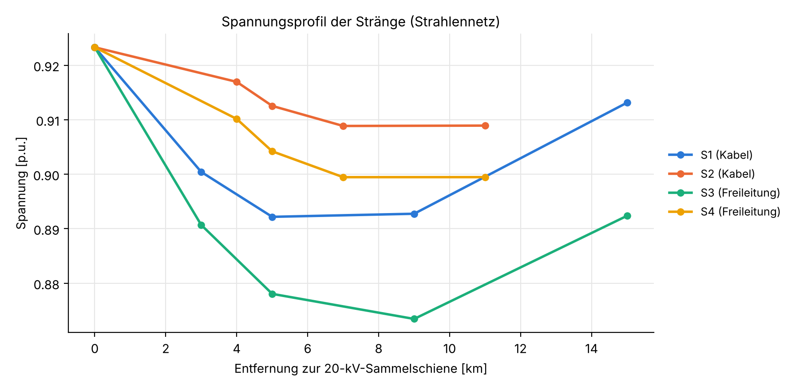

# Aufgabe 1: Mittelspannungsnetz in Ringtopologie

Strahlennetz: Die Trennstellen am Ende der Stränge sind geöffnet. Spannung am externen Netz 1.0 p.u.

## Netzdaten

### Transformator

| Typ | S_r [MVA] | U_OS / U_US [kV] | u_k [%] | u_kr [%] | P_Fe [kW] | Stufen | Stufe [%] |
| :--- | ---: | :--- | ---: | ---: | ---: | :--- | ---: |
| 40 MVA 110/20 kV | 40 | 110 / 20 | 16.20 | 0.34 | 18 | -9 … 9 | 1.50 |

### Leitungen

| Leitungstyp | Art | R' [Ω/km] | X' [Ω/km] | C' [nF/km] | X/R | I_max [A] |
| :--- | :--- | ---: | ---: | ---: | ---: | ---: |
| NA2XS2Y 1x150 RM/25 12/20 kV | Kabel | 0.206 | 0.116 | 250 | 0.56 | 319 |
| 149-AL1/24-ST1A 20.0 | Freileitung | 0.194 | 0.337 | 10 | 1.74 | 470 |

### Stränge

| Strang | Leitungstyp | Abschnitte [km] | Länge [km] |
| :--- | :--- | :--- | ---: |
| S1 | NA2XS2Y 1x150 RM/25 12/20 kV | 3 / 2 / 4 / 6 | 15 |
| S2 | NA2XS2Y 1x150 RM/25 12/20 kV | 4 / 1 / 2 / 4 | 11 |
| S3 | 149-AL1/24-ST1A 20.0 | 3 / 2 / 4 / 6 | 15 |
| S4 | 149-AL1/24-ST1A 20.0 | 4 / 1 / 2 / 4 | 11 |

### Lasten und Generatoren

| Element | Knoten | P [MW] | cos φ | Q [Mvar] |
| :--- | :--- | ---: | :--- | ---: |
| V1 | S1 K1 | 5.2 | 0.95 ind. | 1.71 |
| V2 | S1 K2 | 6.5 | 0.97 ind. | 1.63 |
| V3 | S1 K3 | 4.8 | 0.95 ind. | 1.58 |
| V4 | S2 K2 | 3.6 | 0.90 ind. | 1.74 |
| V5 | S2 K3 | 2.8 | 0.95 ind. | 0.92 |
| V6 | S3 K1 | 5.2 | 0.95 ind. | 1.71 |
| V7 | S3 K2 | 6.5 | 0.97 ind. | 1.63 |
| V8 | S3 K3 | 4.8 | 0.95 ind. | 1.58 |
| V9 | S4 K2 | 3.6 | 0.90 ind. | 1.74 |
| V10 | S4 K3 | 2.8 | 0.95 ind. | 0.92 |
| G1 | S1 K4 | 6.0 | 1.00 | 0.00 |
| G2 | S2 K1 | 5.0 | 1.00 | 0.00 |
| G3 | S3 K4 | 6.0 | 1.00 | 0.00 |
| G4 | S4 K1 | 5.0 | 1.00 | 0.00 |

## 1.1 Lastfluss und Spannungsabfall

Lastfluss konvergiert: **ja**. Diagnosefunktion: keine Auffälligkeiten.

Spannungsabfall bezogen auf die Nennspannung 20 kV:

| Knoten | U [p.u.] | U [kV] | ΔU [%] |
| :--- | ---: | ---: | ---: |
| Sammelschiene 20 kV | 0.9233 | 18.47 | 7.67 |
| S1 K1 | 0.9004 | 18.01 | 9.96 |
| S1 K2 | 0.8922 | 17.84 | 10.78 |
| S1 K3 | 0.8927 | 17.85 | 10.73 |
| S1 K4 | 0.9131 | 18.26 | 8.69 |
| S2 K1 | 0.9170 | 18.34 | 8.30 |
| S2 K2 | 0.9125 | 18.25 | 8.75 |
| S2 K3 | 0.9089 | 18.18 | 9.11 |
| S2 K4 | 0.9089 | 18.18 | 9.11 |
| S3 K1 | 0.8907 | 17.81 | 10.93 |
| S3 K2 | 0.8780 | 17.56 | 12.20 |
| S3 K3 | 0.8734 | 17.47 | 12.66 |
| S3 K4 | 0.8924 | 17.85 | 10.76 |
| S4 K1 | 0.9101 | 18.20 | 8.99 |
| S4 K2 | 0.9042 | 18.08 | 9.58 |
| S4 K3 | 0.8995 | 17.99 | 10.05 |
| S4 K4 | 0.8995 | 17.99 | 10.05 |

Maximaler Spannungsabfall: **12.66 %** am Knoten **S3 K3** (0.8734 p.u.).

**Antwort:** Der Lastfluss konvergiert, die Diagnosefunktion meldet keine Auffälligkeiten. Der größte Spannungsabfall tritt mit **12,66 %** am Knoten **S3 K3** auf (bezogen auf 20 kV). Davon fallen bereits 7,67 % über dem Transformator ab (Sammelschiene 0,9233 p.u.), im Strang selbst noch rund 5,0 %. Mehrere Knoten liegen unter 0,9 p.u. und damit außerhalb des üblichen Bands von ±10 %; ohne Spannungsregelung ist das Netz so nicht zulässig betreibbar.

## 1.2 Leistungsaustausch mit dem externen Netz

| P [MW] | Q [Mvar] | S [MVA] | cos φ | Trafo-Auslastung [%] |
| ---: | ---: | ---: | ---: | ---: |
| 24.93 | 19.75 | 31.80 | 0.784 | 79.5 |

Kontrolle über die Leistungsbilanz:

| Anteil | P [MW] | Q [Mvar] |
| :--- | ---: | ---: |
| Lasten | 45.800 | 15.160 |
| − Erzeugung | −22.000 | 0.000 |
| + Verluste Leitungen | 1.027 | 0.486 |
| + Verluste Transformator | 0.103 | 4.101 |
| **= Summe** | **24.930** | **19.746** |
| Externes Netz (`res_ext_grid`) | 24.930 | 19.746 |

**Antwort:** Die ausgetauschte Leistung ist das Ergebnis des externen Netzes (Slack) und steht in `net.res_ext_grid` (alternativ auf der Oberspannungsseite des Trafos in `net.res_trafo`). Zur Kontrolle lässt sie sich aus der Leistungsbilanz bestimmen: Summe der Lasten minus Summe der Erzeugung plus alle Verluste. Für die Blindleistung gilt dasselbe mit der Blindleistungsaufnahme von Leitungen und Trafo.

## 1.3 Vergleich der Stränge

| Strang | Art | Länge [km] | P Last [MW] | P Erzeugung [MW] | P Saldo [MW] | I max [A] | max. Auslastung [%] | U min [p.u.] | U Ende [p.u.] |
| :--- | :--- | ---: | ---: | ---: | ---: | ---: | ---: | ---: | ---: |
| S1 | Kabel | 15 | 16.5 | 6.0 | 10.5 | 375 | 117.5 | 0.8922 | 0.9131 |
| S2 | Kabel | 11 | 6.4 | 5.0 | 1.4 | 218 | 68.3 | 0.9089 | 0.9089 |
| S3 | Freileitung | 15 | 16.5 | 6.0 | 10.5 | 386 | 82.1 | 0.8734 | 0.8924 |
| S4 | Freileitung | 11 | 6.4 | 5.0 | 1.4 | 222 | 47.2 | 0.8995 | 0.8995 |

### Leitungsabschnitte

| Leitung | von | nach | Länge [km] | I [A] | Auslastung [%] | P_V [kW] | Q_V [kvar] |
| :--- | :--- | :--- | ---: | ---: | ---: | ---: | ---: |
| S1 L1 | Sammelschiene 20 kV | S1 K1 | 3 | 375 | 117.5 | 259.6 | 67.8 |
| S1 L2 | S1 K1 | S1 K2 | 2 | 202 | 63.2 | 50.0 | −22.3 |
| S1 L3 | S1 K2 | S1 K3 | 4 | 59 | 18.6 | 8.4 | −95.4 |
| S1 L4 | S1 K3 | S1 K4 | 6 | 190 | 59.5 | 133.4 | −78.6 |
| S2 L1 | Sammelschiene 20 kV | S2 K1 | 4 | 91 | 28.5 | 19.8 | −95.2 |
| S2 L2 | S2 K1 | S2 K2 | 1 | 218 | 68.3 | 29.3 | −9.8 |
| S2 L3 | S2 K2 | S2 K3 | 2 | 93 | 29.0 | 10.6 | −46.2 |
| S2 L4 | S2 K3 | S2 K4 | 4 | 3 | 1.0 | 0.0 | −103.8 |
| S3 L1 | Sammelschiene 20 kV | S3 K1 | 3 | 386 | 82.1 | 260.1 | 448.6 |
| S3 L2 | S3 K1 | S3 K2 | 2 | 212 | 45.1 | 52.2 | 88.6 |
| S3 L3 | S3 K2 | S3 K3 | 4 | 69 | 14.7 | 11.1 | 15.3 |
| S3 L4 | S3 K3 | S3 K4 | 6 | 194 | 41.3 | 131.6 | 222.4 |
| S4 L1 | Sammelschiene 20 kV | S4 K1 | 4 | 98 | 20.8 | 22.2 | 34.1 |
| S4 L2 | S4 K1 | S4 K2 | 1 | 222 | 47.2 | 28.6 | 48.6 |
| S4 L3 | S4 K2 | S4 K3 | 2 | 95 | 20.1 | 10.4 | 15.9 |
| S4 L4 | S4 K3 | S4 K4 | 4 | 0 | 0.0 | 0.0 | −4.3 |

**Antwort:** Die äußeren Stränge S1 und S3 versorgen deutlich mehr Last (Saldo 10,5 MW gegenüber 1,4 MW) über eine größere Länge (15 km gegenüber 11 km). Sie sind daher wesentlich höher ausgelastet und haben den größeren Spannungsabfall. Am Ende von S1 und S3 steigt die Spannung wieder an, weil G1 bzw. G3 dort einspeisen; in S2 und S4 liegt das Minimum am Strangende.

Bei gleicher Belastung unterscheiden sich Kabel und Freileitung: Die Ströme sind ähnlich (S1 375 A, S3 386 A), das Kabel ist mit I_max = 319 A aber zu **117 % überlastet**, die Freileitung mit I_max = 470 A nur zu 82 % ausgelastet. Dafür ist der Spannungsabfall auf der Freileitung größer (U min 0,873 statt 0,892 p.u.), weil ihr Längsblindwiderstand X' fast dreimal so groß ist und die induktive Blindleistung der Lasten dort stärker wirkt; das Kabel liefert zusätzlich kapazitive Blindleistung.

## 1.4 Verluste und Blindleistung

Q > 0: Aufnahme von Blindleistung, Q < 0: Abgabe (kapazitiv).

|  | P_V [kW] | Q_V [kvar] |
| :--- | ---: | ---: |
| S1 | 451.4 | −128.4 |
| S2 | 59.6 | −255.0 |
| S3 | 455.0 | 774.9 |
| S4 | 61.2 | 94.4 |
| **Leitungen gesamt** | 1027.3 | 485.8 |
| Transformator | 102.5 | 4100.9 |
| **Netz gesamt** | 1129.8 | 4586.7 |

**Antwort:** Die Verluste betragen 1027 kW auf den Leitungen und 103 kW im Transformator, zusammen **1130 kW** (rund 4,5 % der bezogenen Leistung). Sie entstehen fast vollständig in den hoch belasteten Strängen S1 und S3 (je rund 450 kW). Die Blindleistungsaufnahme des Netzes beträgt **4587 kvar**, davon 4101 kvar im Transformator. Die Kabel geben wegen ihrer Kapazität Blindleistung ab (negatives Q), die Freileitungen nehmen Blindleistung auf.
