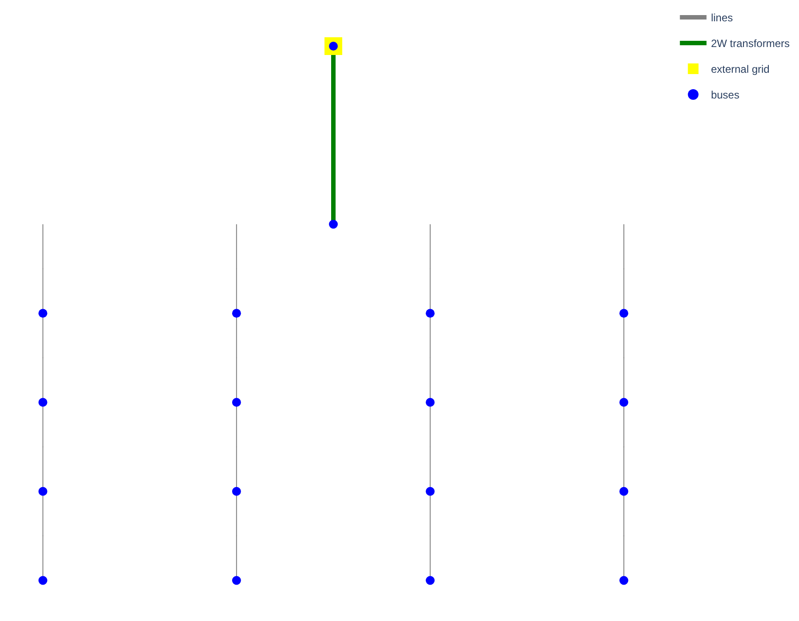
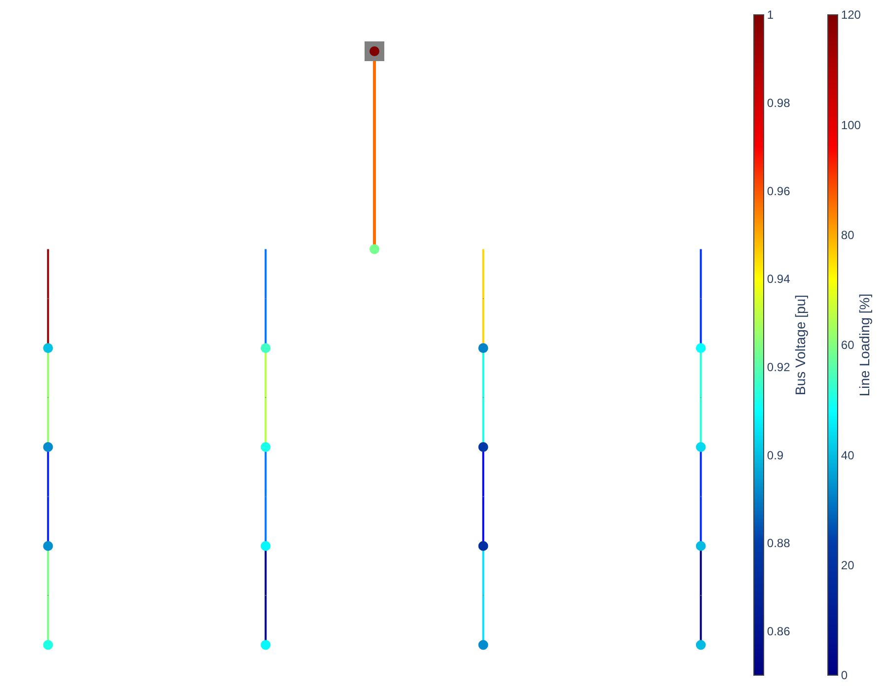

# Aufgabe 2: Graphische Darstellung des Netzes

## Netzgrafik

Erstellt wie in der Anleitung:

```python
from pandapower.plotting.plotly import simple_plotly
import plotly.io as pio
pio.templates.default = "plotly_white"
simple_plotly(net)
```



Interaktive Fassung: [aufgabe2_netz.html](aufgabe2_netz.html)

Die Grafik zeigt die Knoten (blau), die Leitungen (grau), den Transformator (grün) und das externe Netz (gelb). Damit sie wie Abbildung 1 aussieht, haben die Knoten in `netz.py` Koordinaten bekommen: links der Kabelring (S1, S2), rechts der Freileitungsring (S3, S4). Ohne Koordinaten erzeugt pandapower eine automatische Anordnung. Lasten, Generatoren und die offenen Trennstellen stellt `simple_plotly` nicht dar.

## Ergänzend: Ergebnisdarstellung (Strahlennetz)

Erstellt mit `pf_res_plotly(net)` nach der Lastflussberechnung (Farbskalen: Spannung 0,85–1,0 p.u., Auslastung 0–120 %).



Interaktive Fassung: [aufgabe2_ergebnis.html](aufgabe2_ergebnis.html)

Die Ergebnisdarstellung färbt die Knoten nach ihrer Spannung und die Leitungen nach ihrer Auslastung. Gut zu erkennen sind die niedrigen Spannungen im Freileitungsstrang S3 und die Überlastung des ersten Kabelabschnitts in S1.
