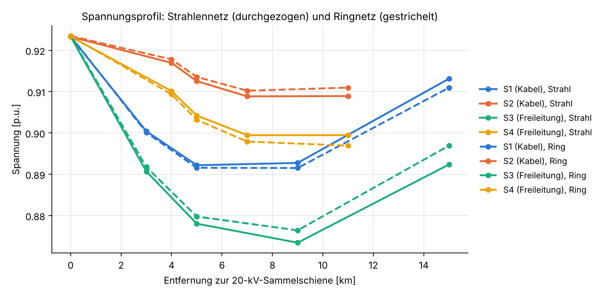

# Aufgabe 3: Spannungsabfall im Mittelspannungsnetz

Netz wie in Aufgabe 1. Strahlennetz: Trennstellen offen; Ringnetz: Trennstellen geschlossen.

## 3.1 Strahlennetz

Knotenspannungen (ΔU bezogen auf 20 kV):

| Knoten | U [p.u.] | U [kV] | ΔU [%] |
| :--- | ---: | ---: | ---: |
| Sammelschiene 20 kV | 0.9233 | 18.47 | 7.67 |
| S1 K1 | 0.9004 | 18.01 | 9.96 |
| S1 K2 | 0.8922 | 17.84 | 10.78 |
| S1 K3 | 0.8927 | 17.85 | 10.73 |
| S1 K4 | 0.9131 | 18.26 | 8.69 |
| S2 K1 | 0.9170 | 18.34 | 8.30 |
| S2 K2 | 0.9125 | 18.25 | 8.75 |
| S2 K3 | 0.9089 | 18.18 | 9.11 |
| S2 K4 | 0.9089 | 18.18 | 9.11 |
| S3 K1 | 0.8907 | 17.81 | 10.93 |
| S3 K2 | 0.8780 | 17.56 | 12.20 |
| S3 K3 | 0.8734 | 17.47 | 12.66 |
| S3 K4 | 0.8924 | 17.85 | 10.76 |
| S4 K1 | 0.9101 | 18.20 | 8.99 |
| S4 K2 | 0.9042 | 18.08 | 9.58 |
| S4 K3 | 0.8995 | 17.99 | 10.05 |
| S4 K4 | 0.8995 | 17.99 | 10.05 |

Verlustleistung gesamt: **1129.8 kW** (Leitungen 1027.3 kW, Transformator 102.5 kW).

## 3.2 Ringnetz

Knotenspannungen (ΔU bezogen auf 20 kV):

| Knoten | U [p.u.] | U [kV] | ΔU [%] |
| :--- | ---: | ---: | ---: |
| Sammelschiene 20 kV | 0.9235 | 18.47 | 7.65 |
| S1 K1 | 0.9001 | 18.00 | 9.99 |
| S1 K2 | 0.8916 | 17.83 | 10.84 |
| S1 K3 | 0.8915 | 17.83 | 10.85 |
| S1 K4 | 0.9110 | 18.22 | 8.90 |
| S2 K1 | 0.9178 | 18.36 | 8.22 |
| S2 K2 | 0.9136 | 18.27 | 8.64 |
| S2 K3 | 0.9102 | 18.20 | 8.98 |
| S2 K4 | 0.9110 | 18.22 | 8.90 |
| S3 K1 | 0.8918 | 17.84 | 10.82 |
| S3 K2 | 0.8798 | 17.60 | 12.02 |
| S3 K3 | 0.8764 | 17.53 | 12.36 |
| S3 K4 | 0.8969 | 17.94 | 10.31 |
| S4 K1 | 0.9093 | 18.19 | 9.07 |
| S4 K2 | 0.9032 | 18.06 | 9.68 |
| S4 K3 | 0.8979 | 17.96 | 10.21 |
| S4 K4 | 0.8969 | 17.94 | 10.31 |

Verlustleistung gesamt: **1104.8 kW** (Leitungen 1002.5 kW, Transformator 102.3 kW).

## 3.3 Vergleich

### Sammelschiene und Strangenden

| Knoten | U Strahl [p.u.] | U Ring [p.u.] | ΔU [p.u.] | ΔU [V] |
| :--- | ---: | ---: | ---: | ---: |
| Sammelschiene 20 kV | 0.9233 | 0.9235 | 0.0002 | 3 |
| S1 K4 | 0.9131 | 0.9110 | −0.0022 | −43 |
| S2 K4 | 0.9089 | 0.9110 | 0.0020 | 41 |
| S3 K4 | 0.8924 | 0.8969 | 0.0046 | 91 |
| S4 K4 | 0.8995 | 0.8969 | −0.0025 | −51 |

### Verluste

|  | P_V Strahl [kW] | P_V Ring [kW] | ΔP_V [kW] | Q_V Strahl [kvar] | Q_V Ring [kvar] |
| :--- | ---: | ---: | ---: | ---: | ---: |
| S1 | 451.4 | 442.9 | −8.6 | −128.4 | −132.4 |
| S2 | 59.6 | 58.8 | −0.8 | −255.0 | −256.2 |
| S3 | 455.0 | 436.4 | −18.6 | 774.9 | 742.4 |
| S4 | 61.2 | 64.4 | 3.2 | 94.4 | 100.0 |
| **Leitungen gesamt** | 1027.3 | 1002.5 | −24.8 | 485.8 | 453.9 |
| Transformator | 102.5 | 102.3 | −0.3 | 4100.9 | 4088.8 |
| **Netz gesamt** | 1129.8 | 1104.8 | −25.0 | 4586.7 | 4542.7 |

### Stränge

| Strang | max. Auslastung Strahl [%] | max. Auslastung Ring [%] | U min Strahl [p.u.] | U min Ring [p.u.] |
| :--- | ---: | ---: | ---: | ---: |
| S1 | 117.5 | 120.7 | 0.8922 | 0.8915 |
| S2 | 68.3 | 65.0 | 0.9089 | 0.9102 |
| S3 | 82.1 | 83.8 | 0.8734 | 0.8764 |
| S4 | 47.2 | 45.4 | 0.8995 | 0.8969 |

### Alle Knoten

| Knoten | U Strahl [p.u.] | U Ring [p.u.] | ΔU [p.u.] | ΔU [V] |
| :--- | ---: | ---: | ---: | ---: |
| Sammelschiene 20 kV | 0.9233 | 0.9235 | 0.0002 | 3 |
| S1 K1 | 0.9004 | 0.9001 | −0.0003 | −6 |
| S1 K2 | 0.8922 | 0.8916 | −0.0006 | −12 |
| S1 K3 | 0.8927 | 0.8915 | −0.0012 | −25 |
| S1 K4 | 0.9131 | 0.9110 | −0.0022 | −43 |
| S2 K1 | 0.9170 | 0.9178 | 0.0008 | 17 |
| S2 K2 | 0.9125 | 0.9136 | 0.0010 | 20 |
| S2 K3 | 0.9089 | 0.9102 | 0.0014 | 27 |
| S2 K4 | 0.9089 | 0.9110 | 0.0020 | 41 |
| S3 K1 | 0.8907 | 0.8918 | 0.0011 | 21 |
| S3 K2 | 0.8780 | 0.8798 | 0.0017 | 34 |
| S3 K3 | 0.8734 | 0.8764 | 0.0030 | 60 |
| S3 K4 | 0.8924 | 0.8969 | 0.0046 | 91 |
| S4 K1 | 0.9101 | 0.9093 | −0.0008 | −16 |
| S4 K2 | 0.9042 | 0.9032 | −0.0010 | −21 |
| S4 K3 | 0.8995 | 0.8979 | −0.0015 | −31 |
| S4 K4 | 0.8995 | 0.8969 | −0.0025 | −51 |

**Antwort:** Im Ringnetz sind die beiden Strangenden eines Rings direkt verbunden und haben deshalb dieselbe Spannung: Im Kabelring gleichen sich S1 K4 und S2 K4 auf 0,9110 p.u. an, im Freileitungsring S3 K4 und S4 K4 auf 0,8969 p.u. Der Strang mit der vorher niedrigeren Endspannung wird dabei angehoben, der andere abgesenkt. Die Sammelschiene ändert sich praktisch nicht (+0,0002 p.u.). Die Verluste sinken um 25 kW auf 1105 kW (−2,2 %).

Grund: Im Ring wird jeder Knoten über zwei parallele Wege versorgt. Die Leistung teilt sich nach den Impedanzen auf, die Ströme werden gleichmäßiger verteilt, und weil die Verluste quadratisch mit dem Strom steigen, sinken sie insgesamt. Die Änderungen sind hier klein, weil die Spannungen an den Strangenden schon vorher ähnlich waren und dort mit G1 und G3 eingespeist wird.

In beiden Ringen fließen rund 0,6 MW über die geschlossene Trennstelle vom äußeren in den inneren Strang, weil ein Teil der Einspeisung von G1 bzw. G3 jetzt die Lasten in S2 bzw. S4 versorgt. Die inneren Stränge werden dadurch entlastet, die äußeren müssen am Anfang mehr Leistung übertragen: Der erste Kabelabschnitt von S1 ist mit 120,7 % statt 117,5 % sogar noch stärker überlastet. Der Ringschluss allein löst die Überlastung also nicht.
