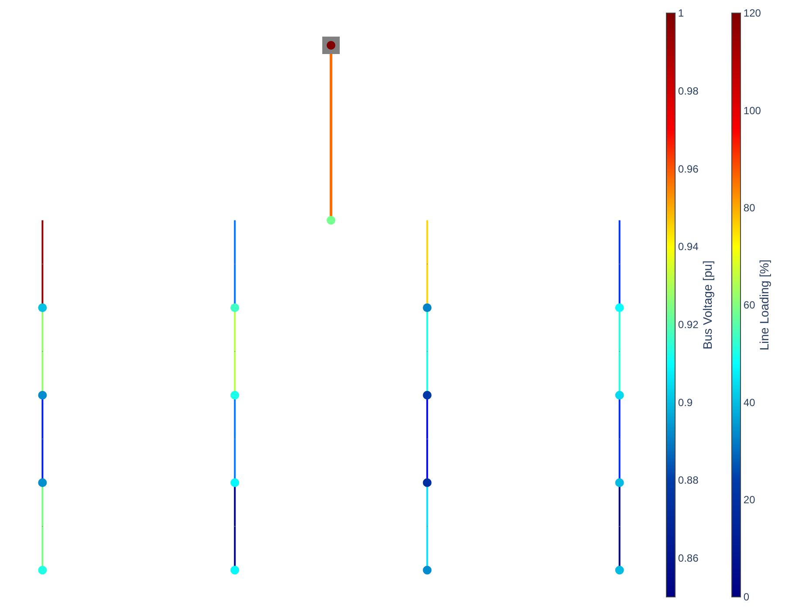

# Labor Elektrische Anlagen und Netze 1: Netzberechnung mit pandapower

Netzberechnungen mit [pandapower](https://www.pandapower.org/) für das Labor
*Elektrische Anlagen und Netze 1* (WS 2026/27). Jeder Versuch hat einen eigenen
Ordner; die Ergebnisse werden automatisch als Markdown-Bericht erzeugt.

| Versuch | Thema | Bericht |
| :--- | :--- | :--- |
| [EAN-V4](EAN-V4) | Einführung in die Netzberechnung: Niederspannungsstrang mit Lasten und Generatoren | [Abgabe_EAN-V4.md](EAN-V4/abgabe/Abgabe_EAN-V4.md) |
| [EAN-V5](EAN-V5) | Mittelspannungsnetz in Ringtopologie: Strahlen- und Ringnetz | [Abgabe_EAN-V5.md](EAN-V5/abgabe/Abgabe_EAN-V5.md) |



## Aufbau

```
netzberechnung.py        gemeinsamer Code: Lastfluss, Tabellen, Netzplan, Spannungsprofile
abgabe_werkzeug.py       gemeinsamer Code: Bericht zusammenfassen, Bilder einbetten, ZIPs
requirements.txt
EAN-V4/
EAN-V5/
```

Jeder Versuchsordner ist gleich aufgebaut:

| Datei | Inhalt |
| :--- | :--- |
| `aufgabeN_grundgeruest.py` | einfache Fassung zum Nachvollziehen im Labor: Netz aufbauen, rechnen, ausgeben |
| `aufgabeN.py` | Auswertung mit Eingaben oben (Netzdaten, Varianten, Antworten) und Markdown als Ergebnis |
| `netz.py` (nur V5) | Netzdaten und gemeinsamer Code der V5-Aufgaben |
| `abgabe.py` | rechnet alle Aufgaben des Versuchs und erstellt die Abgabe |
| `ergebnisse/` | Ergebnisse je Aufgabe und alle Bilder |
| `abgabe/Abgabe_EAN-Vx.md` | Bericht mit verlinkten Bildern (für GitHub) |
| `abgabe/Abgabe_EAN-Vx_mit_Bildern.md` | Bericht als einzelne Datei, Bilder eingebettet |
| `abgabe/Abgabe_EAN-Vx.zip` | alles: gemeinsamer Code, Skripte, Ergebnisse, Bericht |
| `abgabe/Abgabe_EAN-Vx_Bericht.zip` | nur der Bericht und seine Bilder (für Stud.IP) |

## Ausführen

```bash
pip install -r requirements.txt
```

```bash
python EAN-V5/abgabe.py
```

Das rechnet alle Aufgaben des Versuchs neu und schreibt Ergebnisse, Bericht und
ZIP-Dateien. Einzelne Aufgaben lassen sich auch direkt starten oder in Spyder
mit F5. Alle Ausgaben landen immer im jeweiligen Versuchsordner, egal von wo
gestartet wird. Die Grundgerüste von V5 Aufgabe 2 und 3 laden das Netz, das
`aufgabe1_grundgeruest.py` als `mittelspannungsnetz.json` speichert.

Für die Bilder in V5 Aufgabe 2 braucht plotly das Paket `kaleido` und einen
installierten Chrome- oder Edge-Browser; ohne beides wird nur die interaktive
HTML-Grafik gespeichert.

## Netz anpassen

**EAN-V4:** In `aufgabe1.py` und `aufgabe2.py` steht oben ein Abschnitt
`NETZDATEN` (Werte in kW, kvar und m). In `aufgabe2.py` beschreibt `ABSCHNITTE`
jede Teilaufgabe mit einer gemeinsamen Einstellung und den Varianten, z. B.
`{"titel": "P = 10 kW", "G4": {"p_kw": 10}}`.

**EAN-V5:** Die Netzdaten stehen oben in `netz.py` (Trafo, Leitungstypen,
Stränge mit Längen, Trennstellen, Lasten mit cos φ, Generatoren; Werte in MW und
km). Die Antworten zu den Fragen stehen oben in `aufgabe1.py` bis `aufgabe3.py`.

Antworten und Beobachtungen stehen jeweils bei `NOTIZEN` bzw. `"notiz"` und
erscheinen im Bericht.

## Vorzeichen

- **Lasten:** P, Q > 0 = Bezug (Q > 0 induktiv)
- **Generatoren (Static Generator):** P > 0 = Einspeisung; Q < 0 = Aufnahme von
  Blindleistung (induktiv, untererregt), Q > 0 = Abgabe (kapazitiv, übererregt)
- **Externes Netz:** P, Q > 0 = Bezug aus dem vorgelagerten Netz, < 0 = Rückspeisung
- **Verluste:** Q > 0 = Aufnahme von Blindleistung, Q < 0 = Abgabe (z. B. Kabelkapazität)

## Grenzen

- Der Netzplan in V4 ist für einen Strang ausgelegt; bei verzweigten Netzen stimmen
  die Tabellen, aber die Zeichnung kann sich überlagern.
- Konvergiert eine Variante nicht, wird das im Bericht vermerkt und die übrigen
  Varianten werden trotzdem berechnet.
