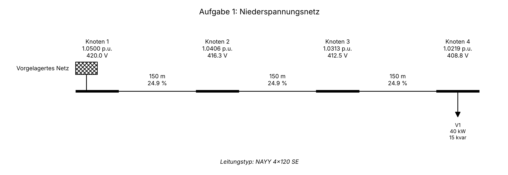

# Aufgabe 1: Netzmodell für ein Niederspannungsnetz

## Einlinienersatzschaltbild

## Knotenspannungen

| Knoten | U [p.u.] | U [V] | Winkel [°] |
| :--- | ---: | ---: | ---: |
| Knoten 1 | 1.0500 | 420.0 | 0.000 |
| Knoten 2 | 1.0406 | 416.3 | 0.009 |
| Knoten 3 | 1.0313 | 412.5 | 0.017 |
| Knoten 4 | 1.0219 | 408.8 | 0.026 |

## Leitungen

| Leitung | von | nach | Typ | Länge [m] | I [A] | Auslastung [%] | P_Verlust [kW] | Q_Verlust [kvar] |
| :--- | :--- | :--- | :--- | ---: | ---: | ---: | ---: | ---: |
| Leitung 1-2 | Knoten 1 | Knoten 2 | NAYY 4x120 SE | 150 | 60.3 | 24.9 | 0.369 | 0.129 |
| Leitung 2-3 | Knoten 2 | Knoten 3 | NAYY 4x120 SE | 150 | 60.3 | 24.9 | 0.369 | 0.129 |
| Leitung 3-4 | Knoten 3 | Knoten 4 | NAYY 4x120 SE | 150 | 60.3 | 24.9 | 0.369 | 0.129 |

## Externes Netz

Positive Werte: das externe Netz speist ein; negative Werte: Rückspeisung.

| Externes Netz | Knoten | U_soll [p.u.] | P [kW] | Q [kvar] |
| :--- | :--- | ---: | ---: | ---: |
| Vorgelagertes Netz | Knoten 1 | 1.05 | 41.11 | 15.39 |

## Lasten

| Last | Knoten | in Betrieb | P [kW] | Q [kvar] |
| :--- | :--- | :--- | ---: | ---: |
| V1 | Knoten 4 | ja | 40.00 | 15.00 |

## Leitungstypen

| Leitungstyp | R' [Ω/km] | X' [Ω/km] | X/R | I_max [A] |
| :--- | ---: | ---: | ---: | ---: |
| NAYY 4x120 SE | 0.225 | 0.080 | 0.356 | 242 |
