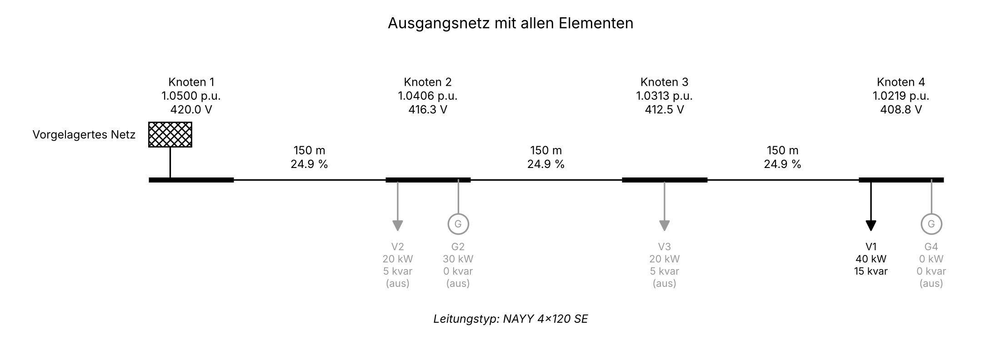
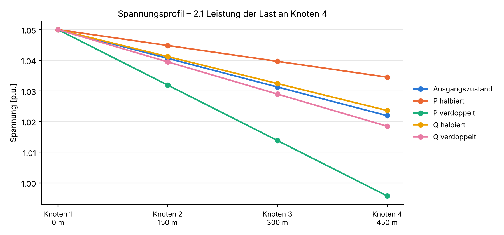
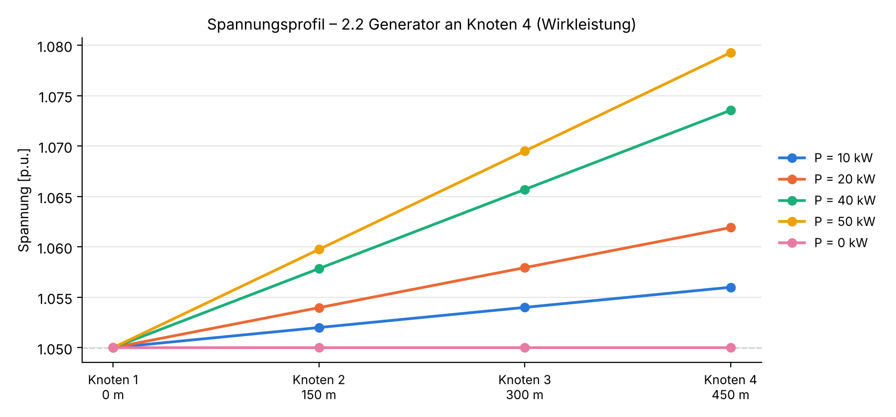
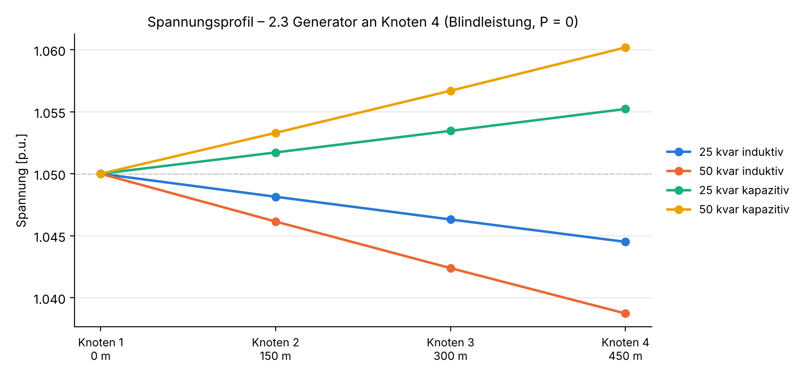
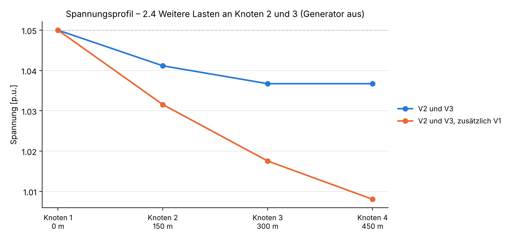
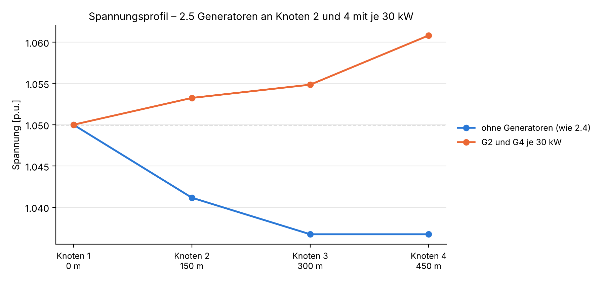
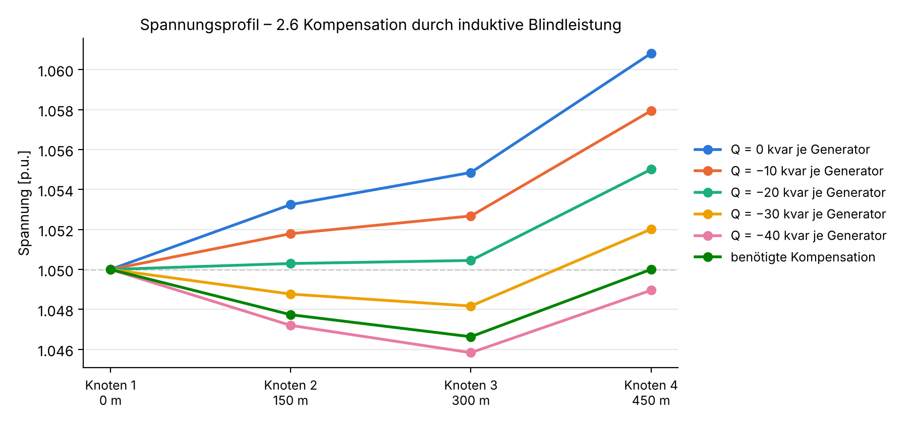

# Aufgabe 2: Erweiterung des Netzmodells

## Netzmodell

Alle in Aufgabe 2 verwendeten Elemente; ausgeschaltete sind grau dargestellt. Spannungen und Auslastungen gelten für den Ausgangszustand.

### Leitungstypen

| Leitungstyp | R' [Ω/km] | X' [Ω/km] | X/R | I_max [A] |
| :--- | ---: | ---: | ---: | ---: |
| NAYY 4x120 SE | 0.225 | 0.080 | 0.356 | 242 |

### Elemente im Ausgangszustand

| Element | Art | Knoten | in Betrieb | P [kW] | Q [kvar] |
| :--- | :--- | :--- | :--- | ---: | ---: |
| V1 | Last | Knoten 4 | ja | 40.00 | 15.00 |
| V2 | Last | Knoten 2 | nein | 20.00 | 5.00 |
| V3 | Last | Knoten 3 | nein | 20.00 | 5.00 |
| G4 | Generator | Knoten 4 | nein | 0.00 | 0.00 |
| G2 | Generator | Knoten 2 | nein | 30.00 | 0.00 |

### Vorzeichen

- Lasten: P, Q > 0 = Bezug (Q > 0 induktiv).
- Generatoren: P > 0 = Einspeisung; Q < 0 = Aufnahme von Blindleistung (induktiv), Q > 0 = Abgabe (kapazitiv).
- Externes Netz: P, Q > 0 = Bezug aus dem vorgelagerten Netz, < 0 = Rückspeisung.

## 2.1 Leistung der Last an Knoten 4

| Variante | Einstellung | U Knoten 1 [p.u.] | U Knoten 2 [p.u.] | U Knoten 3 [p.u.] | U Knoten 4 [p.u.] | P ext. Netz [kW] | Q ext. Netz [kvar] | max. Auslastung [%] |
| :--- | :--- | ---: | ---: | ---: | ---: | ---: | ---: | ---: |
| Ausgangszustand | – | 1.0500 | 1.0406 | 1.0313 | 1.0219 | 41.11 | 15.39 | 24.9 |
| P halbiert | V1: P = 20 kW | 1.0500 | 1.0448 | 1.0397 | 1.0345 | 20.37 | 15.12 | 14.4 |
| P verdoppelt | V1: P = 80 kW | 1.0500 | 1.0319 | 1.0138 | 0.9957 | 84.23 | 16.50 | 48.8 |
| Q halbiert | V1: Q = 7.5 kvar | 1.0500 | 1.0412 | 1.0324 | 1.0236 | 41.00 | 7.85 | 23.7 |
| Q verdoppelt | V1: Q = 30 kvar | 1.0500 | 1.0395 | 1.0290 | 1.0185 | 41.53 | 30.54 | 29.3 |

## 2.2 Generator an Knoten 4 (Wirkleistung)

Gemeinsame Einstellung: V1: aus; G4: an

| Variante | Einstellung | U Knoten 1 [p.u.] | U Knoten 2 [p.u.] | U Knoten 3 [p.u.] | U Knoten 4 [p.u.] | P ext. Netz [kW] | Q ext. Netz [kvar] | max. Auslastung [%] |
| :--- | :--- | ---: | ---: | ---: | ---: | ---: | ---: | ---: |
| P = 10 kW | G4: P = 10 kW | 1.0500 | 1.0520 | 1.0540 | 1.0560 | −9.94 | 0.01 | 5.6 |
| P = 20 kW | G4: P = 20 kW | 1.0500 | 1.0540 | 1.0579 | 1.0619 | −19.78 | 0.07 | 11.2 |
| P = 40 kW | G4: P = 40 kW | 1.0500 | 1.0578 | 1.0657 | 1.0735 | −39.12 | 0.31 | 22.2 |
| P = 50 kW | G4: P = 50 kW | 1.0500 | 1.0597 | 1.0695 | 1.0793 | −48.64 | 0.48 | 27.6 |
| P = 0 kW | G4: P = 0 kW | 1.0500 | 1.0500 | 1.0500 | 1.0500 | 0.00 | −0.01 | 0.0 |

## 2.3 Generator an Knoten 4 (Blindleistung, P = 0)

Gemeinsame Einstellung: V1: aus; G4: an

| Variante | Einstellung | U Knoten 1 [p.u.] | U Knoten 2 [p.u.] | U Knoten 3 [p.u.] | U Knoten 4 [p.u.] | P ext. Netz [kW] | Q ext. Netz [kvar] | max. Auslastung [%] |
| :--- | :--- | ---: | ---: | ---: | ---: | ---: | ---: | ---: |
| 25 kvar induktiv | G4: Q = −25 kvar (induktiv) | 1.0500 | 1.0481 | 1.0463 | 1.0445 | 0.36 | 25.12 | 14.3 |
| 50 kvar induktiv | G4: Q = −50 kvar (induktiv) | 1.0500 | 1.0461 | 1.0424 | 1.0387 | 1.47 | 50.51 | 28.7 |
| 25 kvar kapazitiv | G4: Q = 25 kvar (kapazitiv) | 1.0500 | 1.0517 | 1.0535 | 1.0552 | 0.36 | −24.88 | 14.1 |
| 50 kvar kapazitiv | G4: Q = 50 kvar (kapazitiv) | 1.0500 | 1.0533 | 1.0567 | 1.0602 | 1.41 | −49.51 | 28.1 |

## 2.4 Weitere Lasten an Knoten 2 und 3 (Generator aus)

Gemeinsame Einstellung: V1: aus; V2: an; V3: an

| Variante | Einstellung | U Knoten 1 [p.u.] | U Knoten 2 [p.u.] | U Knoten 3 [p.u.] | U Knoten 4 [p.u.] | P ext. Netz [kW] | Q ext. Netz [kvar] | max. Auslastung [%] |
| :--- | :--- | ---: | ---: | ---: | ---: | ---: | ---: | ---: |
| V2 und V3 | – | 1.0500 | 1.0412 | 1.0367 | 1.0367 | 40.42 | 10.14 | 23.7 |
| V2 und V3, zusätzlich V1 | V1: an | 1.0500 | 1.0315 | 1.0175 | 1.0081 | 82.64 | 25.93 | 49.2 |

## 2.5 Generatoren an Knoten 2 und 4 mit je 30 kW

Gemeinsame Einstellung: V1: aus; V2: an; V3: an; G4: an, P = 30 kW; G2: an

| Variante | Einstellung | U Knoten 1 [p.u.] | U Knoten 2 [p.u.] | U Knoten 3 [p.u.] | U Knoten 4 [p.u.] | P ext. Netz [kW] | Q ext. Netz [kvar] | max. Auslastung [%] |
| :--- | :--- | ---: | ---: | ---: | ---: | ---: | ---: | ---: |
| ohne Generatoren (wie 2.4) | G2: aus; G4: aus | 1.0500 | 1.0412 | 1.0367 | 1.0367 | 40.42 | 10.14 | 23.7 |
| G2 und G4 je 30 kW | – | 1.0500 | 1.0532 | 1.0548 | 1.0608 | −19.71 | 10.09 | 16.9 |

## 2.6 Kompensation durch induktive Blindleistung

Gemeinsame Einstellung: V1: aus; V2: an; V3: an; G4: an, P = 30 kW; G2: an

| Variante | Einstellung | U Knoten 1 [p.u.] | U Knoten 2 [p.u.] | U Knoten 3 [p.u.] | U Knoten 4 [p.u.] | P ext. Netz [kW] | Q ext. Netz [kvar] | max. Auslastung [%] |
| :--- | :--- | ---: | ---: | ---: | ---: | ---: | ---: | ---: |
| Q = 0 kvar je Generator | G2: Q = 0 kvar; G4: Q = 0 kvar | 1.0500 | 1.0532 | 1.0548 | 1.0608 | −19.71 | 10.09 | 16.9 |
| Q = −10 kvar je Generator | G2: Q = −10 kvar (induktiv); G4: Q = −10 kvar (induktiv) | 1.0500 | 1.0518 | 1.0527 | 1.0579 | −19.50 | 30.17 | 20.4 |
| Q = −20 kvar je Generator | G2: Q = −20 kvar (induktiv); G4: Q = −20 kvar (induktiv) | 1.0500 | 1.0503 | 1.0504 | 1.0550 | −19.06 | 50.33 | 30.6 |
| Q = −30 kvar je Generator | G2: Q = −30 kvar (induktiv); G4: Q = −30 kvar (induktiv) | 1.0500 | 1.0488 | 1.0482 | 1.0520 | −18.38 | 70.57 | 41.4 |
| Q = −40 kvar je Generator | G2: Q = −40 kvar (induktiv); G4: Q = −40 kvar (induktiv) | 1.0500 | 1.0472 | 1.0458 | 1.0490 | −17.47 | 90.89 | 52.6 |
| **benötigte Kompensation** | G2: Q = −36.6 kvar (induktiv); G4: Q = −36.6 kvar (induktiv) | 1.0500 | 1.0477 | 1.0466 | 1.0500 | −17.81 | 83.99 | 48.8 |

**Kompensation:** Damit keine Knotenspannung über 1.05 p.u. liegt, müssen G2, G4 je **1.22 kvar pro kW** induktive Blindleistung aufnehmen (|Q|/P = 1.22, cos φ = 0.634 untererregt), zusammen 73.2 kvar. G2: −36.6 kvar, G4: −36.6 kvar.

